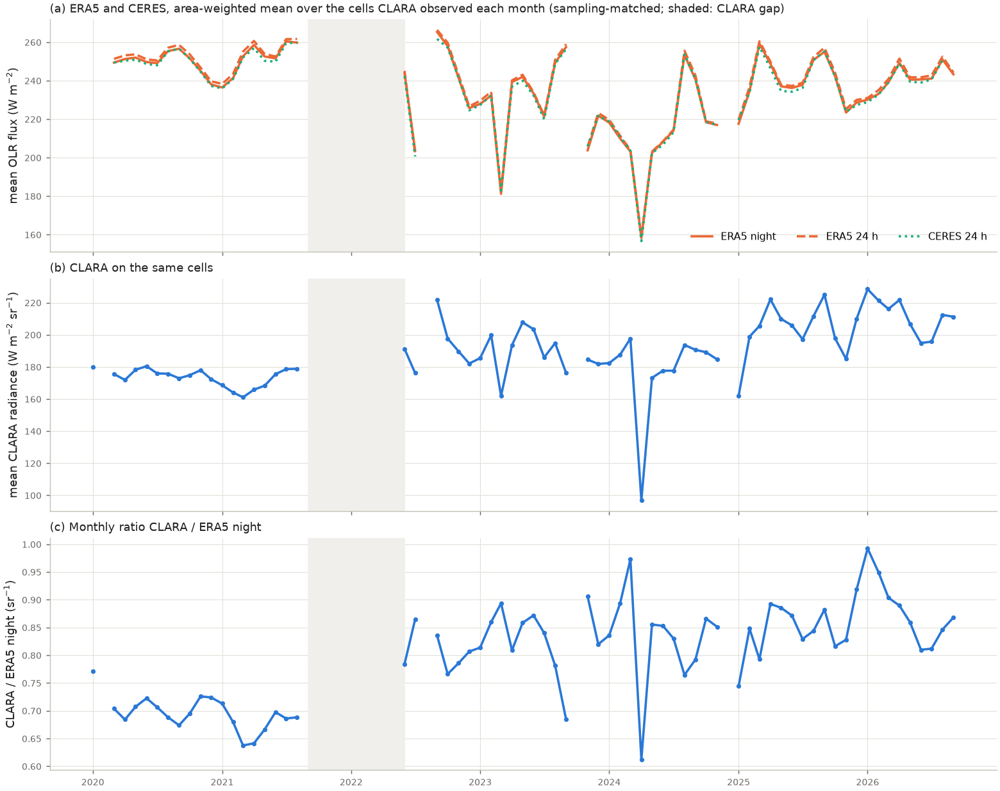
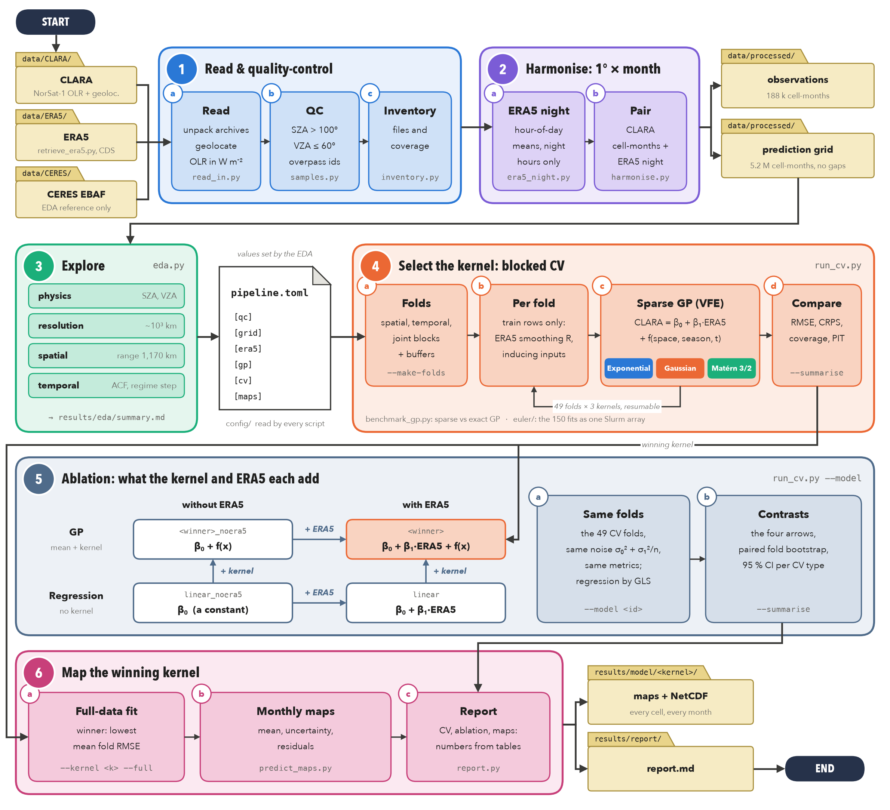

# CLARA OLR from ERA5

*Spatio-temporal Gaussian processes that reconstruct the night-side outgoing longwave radiation seen by the
CLARA radiometer on NorSat-1, on a gap-free 5° × monthly grid.*


## Contents

- [Overview](#overview)
- [Pipeline overview](#pipeline-overview)
- [Installation](#installation)
- [Data](#data)
- [Usage](#usage)
- [Running on Euler](#running-on-euler-eth-cluster)
- [Outputs](#outputs)
- [Method](#method)
- [Data caveats](#data-caveats)
- [Repository layout](#repository-layout)
- [References](#references)

## Overview

CLARA (PMOD/WRC) is a radiometer on the NorSat-1 microsatellite. It samples Earth's outgoing longwave
radiation (OLR) along its orbit every ~30 s, but only on the night side, and with large gaps in space and
time. This project predicts **monthly-mean night-side CLARA OLR for every 5° cell and every month from
2020-01 to 2026-09**. It uses only spatial coordinates, time, ERA5 OLR and a pre/post-gap indicator for
CLARA's calibration step. Three datasets are involved:

- **CLARA** (NorSat-1): the target. Earth-viewing OLR samples with daily geolocation files.
  It is night-side only and not angle-corrected.
- **ERA5** (ECMWF reanalysis, Copernicus CDS): the only physical predictor. ERA5 monthly means by hour of day
  are reduced to a *night-time* monthly mean that matches what CLARA can observe.
- **CERES EBAF Ed4.2.1** (NASA): an independent reference for the exploratory analysis only, never a
  predictor.

Three GP kernels (**Exponential**, **Gaussian** and **Matérn 3/2**) share one model and differ only in the
covariance function. They are compared with **blocked spatio-temporal cross-validation**: whole regions,
whole half-years and region × half-year blocks are held out with buffers. Each kernel is therefore judged on
genuinely out-of-sample predictions. Three reduced models are scored on the same folds to measure what the
kernel and ERA5 each add: the GP without ERA5, and regression with and without ERA5. The winning kernel is
refitted on all data and mapped with its uncertainty.

<p align="center">
  
</p>

*Why a statistical model is needed: CLARA (blue) reads about 77 W m⁻² below night-time ERA5 before the
2021-09 → 2022-05 data gap and about 36 W m⁻² below after it. ERA5 and CERES differ by only 2.4 W m⁻² on
average. Within each period, CLARA follows the month-to-month fluctuations of ERA5
(`results/eda/summary.md`).*

## Pipeline overview

<p align="center">
  
</p>

The pipeline runs in six stages. Folders in the figure are files on disk. Every script reads
`config/pipeline.toml`, and most of its values come from the exploratory analysis. (Redraw the figure with
`python docs/pipeline_diagram.py`.)

1. **Read & quality-control**
   - **a.** `read_in.py` unpacks the CLARA archives, geolocates each footprint, and returns every product
     as OLR in W m⁻² (positive upward) on common lat-lon conventions.
   - **b.** `samples.py` adds the solar zenith angle (SZA) and local solar time at each footprint, the QC
     flags (night side SZA > 100°, viewing zenith angle VZA ≤ 60°) and overpass ids.
   - **c.** `inventory.py` lists every input file, its coverage and the samples left at each QC stage.
2. **Harmonise to 5° × month**
   - **a.** `era5_night.py` builds night-time ERA5 OLR. It weights the hour-of-day monthly means by the
     fraction of the month each hour is night. Polar-day cells, which have no night, fall back to the
     3 darkest hours and are flagged.
   - **b.** `harmonise.py` bins the QC'd CLARA samples into 5° cell-months and pairs each one with ERA5
     night of the same cell and month (1° values area-averaged to 5°). It adds the `post_gap` indicator (1 from
     2021-09 on). It writes the observation table (37,898 cell-months) and the gap-free prediction grid
     (209,952 cell-months = 81 months × 2,592 cells).
3. **Explore.** `eda.py` covers the instrument physics (SZA, VZA), effective resolution, spatial
   correlogram, temporal autocorrelation and agreement statistics. Its `summary.md` is the basis for the QC
   thresholds and the CV block sizes and buffers in the config.
4. **Select the kernel by blocked CV** (`run_cv.py`)
   - **a.** `--make-folds` writes 49 folds (18 spatial, 13 temporal, 18 joint) with a SHA-256 checksum,
     so that every kernel sees identical folds.
   - **b.** Per fold, using training rows only, it picks the ERA5 smoothing radius, standardises, and
     chooses k-means inducing inputs.
   - **c.** It fits the sparse variational GP with each kernel. Runs are resumable, so finished folds are
     skipped.
   - **d.** `--summarise` computes RMSE, CRPS, NLPD, interval coverage and PIT. The winner is the kernel
     with the lowest mean fold RMSE.
5. **Ablation: what the kernel and ERA5 each add** ([`baselines.py`](src/baselines.py))
   - **a.** `run_cv.py --model <id>` scores three reduced models on the same 49 folds, with the same noise
     model, the same pre/post-gap step β₂ and the same metrics as the winner:
     - `<winner>_noera5` is the GP without ERA5 (β₀ + β₂·post_gap + f(x));
     - `linear` is regression without a kernel (β₀ + β₁·ERA5 + β₂·post_gap);
     - `linear_noera5` is a constant per period (β₀ + β₂·post_gap).

     The regression-only models are fitted by exact maximum likelihood (GLS).
   - **b.** `--summarise` reports the four contrasts, the arrows in the figure: adding the kernel with and
     without ERA5, and adding ERA5 with and without the kernel. Each comes with a paired fold-bootstrap 95 % CI.
6. **Map the winning kernel**
   - **a.** `run_cv.py --full` fits the model on all data.
   - **b.** `predict_maps.py` predicts every cell-month and writes them all to one table,
     `grid_predictions.csv`. It draws maps of the prediction and its uncertainty for every month, and maps of
     the observations and residuals for the months CLARA observed.
   - **c.** `report.py` writes the final report, reading every number from the generated tables.

### Modules

| Stage | Script | Role |
|---|---|---|
| 1 | [`retrieve_era5.py`](src/retrieve_era5.py) | Download ERA5 `ttr` (monthly, hourly, monthly-by-hour) from the Copernicus CDS |
| 1 | [`read_in.py`](src/read_in.py) | Read CLARA, CERES and ERA5 into common structures; `--save` caches geolocated CLARA |
| 1 | [`samples.py`](src/samples.py) | CLARA samples with solar geometry, QC flags and overpass ids |
| 1 | [`inventory.py`](src/inventory.py) | Inventory of every input file and of coverage per month |
| 2 | [`era5_night.py`](src/era5_night.py) | ERA5 night-time monthly OLR on 1°; spherical-cap smoothing |
| 2 | [`harmonise.py`](src/harmonise.py) | Observation table and prediction grid on 5° (with `post_gap`), EDA reference table, `decisions.md` |
| 3 | [`eda.py`](src/eda.py) | Exploratory analysis: physics, resolution, spatial, temporal, joint |
| 4 | [`run_cv.py`](src/run_cv.py) | Folds, cross-validation, full-data fits, kernel comparison; Slurm task interface |
| 4 | [`benchmark_gp.py`](src/benchmark_gp.py) | Checks the sparse GP against the exact GP and its sensitivity to M |
| 5 | [`baselines.py`](src/baselines.py) | Regression-only model and the registry of model ids for the 2 × 2 ablation |
| 6 | [`predict_maps.py`](src/predict_maps.py) | Whole-grid prediction table, monthly maps, NetCDF/CSV and global-mean series |
| 6 | [`report.py`](src/report.py) | Final report from the generated tables |
| – | [`gp.py`](src/gp.py) | The GP model, the three kernels and the chunked VFE bound (PyTorch) |
| – | [`cv.py`](src/cv.py) | Fold definitions, metrics, paired block bootstrap, winner criterion |
| – | [`config.py`](src/config.py), [`solar.py`](src/solar.py), [`style.py`](src/style.py) | Config loading, NOAA solar geometry, shared figure style |

**Preliminary comparison.** Five scripts come from the first comparison of the raw CLARA, CERES and ERA5
fields, before the GP pipeline: [`build_matched.py`](src/build_matched.py),
[`plot_raw_means.py`](src/plot_raw_means.py), [`plot_olr_hist.py`](src/plot_olr_hist.py),
[`plot_month_smooth.py`](src/plot_month_smooth.py) and [`correlation.py`](src/correlation.py). They write
to `results/rawmeans_<res>/`, `olr_hist/`, `month_smooth_comparison/` and `correlation/`. They stay in
`src/` because `style.py` and `eda.py` import from them.

## Installation

### 1. Clone the repository

```bash
git clone https://github.com/camillandreozzi/OLR_clara-era5-ceres.git
cd OLR_clara-era5-ceres
```

The raw CLARA and CERES archives (~170 MB) come with the clone.

### 2. Create the Python environment

Python ≥ 3.11 is required (`tomllib`).

```bash
python3 -m venv .venv
.venv/bin/pip install -r requirements.txt
```

### 3. Set up ERA5 access

ERA5 is downloaded from the [Copernicus Climate Data Store](https://cds.climate.copernicus.eu). You need an
account with the ERA5 licence accepted and your token in `~/.cdsapirc`:

```text
url: https://cds.climate.copernicus.eu/api
key: <your-personal-access-token>
```

## Data

| Dataset | Location | Format | In git |
|---|---|---|---|
| CLARA OLR | `data/CLARA/CLARA_OLR.tar.gz` (2020–2024), `CLARA_OLR_<yyyy>.tar.gz` (2025 on) | IDL `.save`, one per month, ~30 s cadence | yes |
| CLARA geolocation | `data/CLARA/CLARA_lat_lon_<yyyy>.tar.gz` | CSV, one per day, 1 min cadence | yes |
| CERES EBAF Ed4.2.1 | `data/CERES/CERES_EBAF-TOA_Ed4.2.1_Subset_202001-202608.nc` | NetCDF, 1°, monthly | yes |
| ERA5 `ttr` | `data/ERA5/monthly/`, `data/ERA5/monthly_by_hour/` | NetCDF, 0.25° | no: `retrieve_era5.py` (~2.7 GB) |
| Intermediates | `data/processed/` | Parquet, NetCDF | no: written by the pipeline (~1 GB) |

The CLARA archives are extracted on first read into `data/CLARA/extracted/`, which is not tracked.

## Usage

All commands run from the repository root.

### 1. Check the configuration

| File | Use |
|---|---|
| [`config/pipeline.toml`](config/pipeline.toml) | Default run (laptop): M = 500 inducing inputs, 1 optimiser start |
| [`config/pipeline_smoke.toml`](config/pipeline_smoke.toml) | Quick end-to-end check: small GP, few folds, writes to `results/model_smoke/` |
| [`config/pipeline_euler.toml`](config/pipeline_euler.toml) | Euler cluster: M = 1000, 3 starts; data and fold settings identical to the default (checked) |

| Section | Sets |
|---|---|
| `[qc]` | Night threshold (SZA > 100°), maximum VZA (60°), overpass gap (20 min) |
| `[grid]` | Model grid spacing (5°) |
| `[era5]` | Night definition and candidate smoothing radii (0–1500 km) |
| `[time]` | Record span, time origin, CLARA data gap (`post_gap` = 1 from `gap_start` on) |
| `[gp]` | Kernels, `gap_step` (the β₂·post_gap term), inducing inputs, optimiser, initial hyperparameters, chunk size |
| `[cv]` | Block sizes, windows and buffers of the three CV types; bootstrap samples |
| `[baselines]` | `gp_noera5_kernels`: the kernel of the GP without ERA5 (set to the winner once the kernel CV is done) |

Each script copies the settings it used next to its outputs (`config_used.json`, `config.json`).

### 2. Run the pipeline

```bash
# 1 · Read & quality-control
python src/retrieve_era5.py                              # ERA5 monthly means, 2020–2026
python src/retrieve_era5.py --product monthly_by_hour    # ERA5 monthly means by hour of day
python src/inventory.py

# 2 · Harmonise
python src/era5_night.py
python src/harmonise.py

# 3 · Explore
python src/eda.py

# 4 · Select the kernel
python src/run_cv.py --make-folds
python src/benchmark_gp.py                               # optional: sparse vs exact GP check
for k in exponential gaussian matern32; do               # the three kernels can run in parallel
  python src/run_cv.py --kernel $k                       # every fold, resumable
  python src/run_cv.py --kernel $k --full                # full-data fit
done
python src/run_cv.py --summarise

# 5 · Ablation on the same folds (--model accepts several ids; --kernel is an alias)
python src/run_cv.py --model linear linear_noera5        # regression only: seconds per fold
python src/run_cv.py --model linear linear_noera5 --full
# set [baselines] gp_noera5_kernels = ["<winner>"], the first row of kernel_comparison.csv, then:
python src/run_cv.py --model <winner>_noera5             # the GP without ERA5
python src/run_cv.py --model <winner>_noera5 --full
python src/run_cv.py --summarise                         # adds model_comparison.csv, model_pairwise.csv

# 6 · Map the winning kernel
python src/predict_maps.py                               # winner read from kernel_comparison.csv
python src/report.py
```

ERA5 downloads resume where they stopped, and a re-run fills in months published since the last one. To
run the modelling stages on the smoke-test configuration, pass `--config config/pipeline_smoke.toml` to
`run_cv.py` and `predict_maps.py`.

### 3. Run the tests

```bash
python -m pytest tests/
```

The tests cover preprocessing, fold construction, the GP and the baselines. One check: with the inducing
inputs equal to the training inputs, the VFE bound equals the exact log marginal likelihood. Another: the
models without ERA5 give identical predictions whether ERA5 is supplied or all-NaN.

## Running on Euler (ETH cluster)

The 150 GP fits (3 full-data fits plus 49 folds × 3 kernels) run as one Slurm job array with
`config/pipeline_euler.toml`. `run_cv.py` checks that this config matches `pipeline.toml` in every data
and fold setting. Only the GP settings differ: M = 1000 inducing inputs and 3 optimiser starts.

```bash
bash euler/setup.sh     # once, on a login node: venv, tests, task count
bash euler/submit.sh    # inducing inputs -> array of 150 fits -> summary
```

Finished fits are skipped, so `sbatch --array=<ids> euler/fit_array.sbatch` reruns only failed tasks.
`results/model/missing_tasks.csv` lists them. To cap the number of running tasks, use
`MAX_PARALLEL=40 bash euler/submit.sh`. Software modules are set in
[`euler/modules.sh`](euler/modules.sh). The maps and the report run locally after copying `results/model/`
back.

**Baselines (stage 5).** These use a separate task list (`--group baselines`) and separate output folders.
The kernel array's task indices never change, so the code can be synced while that array is still running.

```bash
bash euler/submit_baselines.sh   # now: regression-only baselines (one small job) -> summary
# after the kernel summary: set [baselines] gp_noera5_kernels = ["<winner>"] in pipeline_euler.toml, then
bash euler/submit_baselines.sh   # adds the 50 fits of the GP without ERA5 (array, GROUP=baselines)
```

Failed GP-without-ERA5 tasks rerun with `GROUP=baselines sbatch --array=<ids> euler/fit_array.sbatch`.
`results/model/missing_baseline_tasks.csv` lists them.

**Sparse-GP benchmark.** `sbatch euler/benchmark.sbatch` runs `benchmark_gp.py` with the Euler config, one
kernel per array task: VFE against the exact GP, then M = 250, 500, 1000 and 2000 on one spatial fold. It
writes `results/model/benchmark/{vfe_vs_exact,m_sensitivity}_<kernel>.csv`. `bash euler/check.sh` reports
the queue, failed jobs and missing fits of every stage.

**Restarting after a grid or fold change.** Outputs in `results/model/` are valid only for the folds they
were made with, and finished fits are skipped. `run_cv.py --make-folds` therefore refuses to write new folds
while `results/model/` holds fits of other folds. To restart, first cancel the queued jobs. Cancel the
summary first: its `afterany` dependency would otherwise start it as soon as the array ends.

```bash
scancel -u $USER --name=olr-gp-summary
scancel -u $USER --name=olr-gp-fit && scancel -u $USER --name=olr-gp-prep && scancel -u $USER --name=olr-linear
```

Then archive or delete `results/model/` and `logs/`. Make the folds again locally, sync code, folds and
`data/processed/harmonised_<res>deg_monthly.parquet` to Euler, and run `bash euler/submit.sh`.

## Outputs

| Path | Content |
|---|---|
| `results/eda/inventory/` | File inventory, coverage by month, dataset comparison |
| `results/preprocessing/` | `decisions.md` (every preprocessing choice and why), QC attrition, validation checks |
| `results/eda/` | EDA figures and tables, and **`summary.md`** with the key numbers and the CV settings they imply |
| `results/model/folds.csv` | Fold table (+ `folds_sha256.txt`, `fold_summary.csv`) |
| `results/model/benchmark/` | Sparse (VFE) vs exact GP, M sensitivity |
| `results/model/<kernel>/` | Out-of-sample and in-sample predictions, hyperparameters, metrics, `full_model.pt` |
| `results/model/kernel_comparison.csv` | Kernel ranking; `kernel_pairwise.csv` gives bootstrap CIs of the RMSE differences |
| `results/model/linear/`, `linear_noera5/`, `<winner>_noera5/` | The baselines, with the same files as a kernel folder |
| `results/model/model_comparison.csv` | All models (kernels and baselines) on the same folds; `model_pairwise.csv` gives bootstrap CIs for every pair |
| `results/model/figures/` | RMSE by fold, coverage, PIT histograms; `model_comparison.png` (kernels and baselines) |
| `results/model/<winner>/grid_predictions.csv` | **Every cell of every month** in one table (209,952 rows): prediction, uncertainties, ERA5, `post_gap`, CLARA where observed, residuals, flags |
| `results/model/<winner>/<yyyy>/` | Maps for every month (predicted, uncertainty; observed and residuals where CLARA observed), `<yyyy>_predictions.nc`, monthly CSVs |
| `results/model/<winner>/global_mean_monthly.*` | Area-weighted global mean with variance from the full posterior covariance |
| `results/report/report.md` | Final report |

The prediction NetCDF has dims `(time, lat, lon)` on the 5° grid. All values are in W m⁻² unless noted:

| Variable | Description |
|---|---|
| `pred_mean` | GP posterior mean of monthly-mean CLARA night-side OLR |
| `latent_sd` | Posterior SD of the monthly mean (the uncertainty maps) |
| `pred_sd_obs1` | Predictive SD of a new CLARA cell-month mean from one overpass |
| `clara`, `n_overpasses` | Observed CLARA cell-month mean and the number of overpasses behind it |
| `residual_insample`, `residual_oos_spatial` | Observed − predicted: full-data fit, and spatial block CV |
| `mean_fn` | Mean function β₀ + β₁·ERA5 + β₂·post_gap of the prediction |
| `era5_night` | ERA5 night-time OLR used as the predictor |
| `post_gap` | 1 from 2021-09 on (post-gap calibration regime; the gap months included), 0 before |
| `clara_observed`, `night_fallback` | Flags (1/0): CLARA observed the cell-month; polar day, so the prediction is an extrapolation |

Large regenerable files are not tracked (see `.gitignore`). These are the gridded predictions (`*.nc`,
`grid_predictions.csv`, the per-month CSVs), the per-fold caches, and the smoke-test outputs. `predict_maps.py` rebuilds the gridded
files from `full_model.pt`.

## Method

### Grid

The model grid is **5° × 5° × month** (`grid.res_deg`), chosen with the supervisor. It applies both to the
inputs (CLARA cell-month means, ERA5 area means) and to the predictions. It gives 37,898 observed cell-months
and a 209,952 cell-month prediction grid (81 months × 2,592 cells). A 5° cell-month holds a median of 9 CLARA
samples from 4 overpasses before the gap and 2 samples from 1 overpass after it. 5° (~555 km) is no finer than
CLARA's ~10³ km effective resolution. ERA5 night-time OLR is built on 1° cells (night weights per 1° cell)
and area-averaged to 5°; nothing is interpolated or upsampled.

### Model

The model is identical for all three kernels; only κ changes.

$$
\mathrm{CLARA}_i = \beta_0 + \beta_1\,\mathrm{ERA5}^{\mathrm{night}}_i + \beta_2\,\mathrm{post\_gap}_i + f(x_i)
+ \varepsilon_i, \qquad \varepsilon_i \sim \mathcal{N}\left(0,\ \sigma_0^2 + \sigma_1^2 / n_i\right)
$$

$$
k(x, x') = \sigma_A^2\,\kappa(r_A) + \sigma_B^2\,\kappa(r_B)
$$

| Kernel | κ(r) |
|---|---|
| Exponential | $e^{-r}$ |
| Gaussian | $e^{-r^2/2}$ |
| Matérn 3/2 | $(1 + \sqrt{3}\,r)\,e^{-\sqrt{3}\,r}$ |

- **Component A (space × season)** uses chord distances on the sphere and on the seasonal circle, so
  December neighbours January.
- **Calibration step.** `post_gap` is 0 before 2021-09 and 1 from 2021-09 on (`[gp] gap_step`). β₂ is the
  change in CLARA's level across the 2021-09 → 2022-05 data gap at fixed ERA5; β₀ is the pre-gap intercept.
  CLARA never observed the gap months, so they are assigned to the post-gap regime by convention.
- **Component B (space × long-term time)** uses the chord distance on the sphere and the difference in
  years. It absorbs drift beyond the step.
- **Noise.** $n_i$ is the number of CLARA overpasses behind a cell-month, because samples along one
  overpass are strongly correlated.
- **Inference.** The collapsed variational bound of Titsias (2009) (VFE / SGPR) is extended to this
  heteroscedastic noise. Every observation enters the bound. Above `gp.chunk_size` rows the bound is
  accumulated in checkpointed chunks, so memory is O(M × chunk). Hyperparameters are found by L-BFGS from
  fixed, data-independent starts.

The full specification and its reasoning are in the docstrings of [`src/gp.py`](src/gp.py) and
[`src/cv.py`](src/cv.py).

### Cross-validation

| Type | Held out | Buffer | Folds |
|---|---|---|---|
| Spatial | 60° × 60° blocks, all months | 1500 km | 18 |
| Temporal | 6-month windows, everywhere | ±1 month | 13 |
| Joint | 60° × 60° block during a 6-month window | 1500 km and ±1 month | 18 |

Block sizes and buffers come from the EDA. The residual correlogram range at 5° is ~1,060 km, so the
buffer is 1500 km. Every training set keeps data from both sides of the gap, so β₂ is estimable in every
fold (`gp.GP.fit` refuses a training set with only one regime). Everything learned from data is learned per fold on training rows only: the ERA5 smoothing radius,
the standardisation, the inducing inputs and the hyperparameters. The winner criterion was fixed in
advance. For each kernel, take the mean per-fold RMSE of each validation type, then average the three
types with equal weight. Calibration is checked with interval coverage and PIT histograms.

## Data caveats

- **Night side only.** Against hour-matched ERA5, daylit footprints read 69–84 W m⁻² higher than night-side
  ones (shortwave contamination), so only footprints with SZA > 100° are used.
- **Not angle-corrected.** CLARA falls steeply beyond VZA ≈ 60°, and a residual geometry effect remains
  within the kept range. VZA is deliberately not a predictor, so this effect becomes noise.
- **Calibration step.** The CLARA − ERA5 bias changes by about 40 W m⁻² across the 2021-09 → 2022-05 data
  gap. The models include it as a single global offset β₂ from 2021-09 on. When in the gap it happened is
  unknown, so the maps of the gap months (assigned to the post-gap level) are extrapolation, and their
  uncertainty does not include the timing of the step.
- **Polar day.** Cells with no night in a month are never observed by CLARA. Their predictions are
  extrapolation and are hatched on the maps.

Details: [`results/eda/summary.md`](results/eda/summary.md) and
[`results/preprocessing/decisions.md`](results/preprocessing/decisions.md).

## Repository layout

```text
OLR_clara-era5-ceres/
├── config/            pipeline settings: default, smoke test, Euler
├── data/
│   ├── CLARA/         raw CLARA OLR and geolocation archives
│   ├── CERES/         CERES EBAF subset
│   ├── ERA5/          downloaded by retrieve_era5.py (not tracked)
│   └── processed/     pipeline intermediates (not tracked)
├── docs/              pipeline figure and the script that draws it
├── euler/             Slurm scripts for the ETH Euler cluster
├── results/
│   ├── eda/           inventory, exploratory figures and tables, summary.md
│   ├── preprocessing/ QC attrition, validation checks, decisions.md
│   ├── model/         folds, benchmark, CV results per kernel, maps of the winner
│   ├── report/        final report
│   └── correlation/, olr_hist/, rawmeans_*/, month_smooth_comparison/   preliminary comparison
├── src/               pipeline scripts
├── tests/             pytest suite
└── requirements.txt
```

## References

- Titsias, M. (2009). Variational learning of inducing variables in sparse Gaussian processes.
  *Proceedings of AISTATS*, PMLR 5, 567–574.
- Hersbach, H., et al. (2020). The ERA5 global reanalysis. *Quarterly Journal of the Royal Meteorological
  Society*, 146, 1999–2049. [doi:10.1002/qj.3803](https://doi.org/10.1002/qj.3803)
- Loeb, N. G., et al. (2018). Clouds and the Earth's Radiant Energy System (CERES) Energy Balanced and
  Filled (EBAF) Top-of-Atmosphere (TOA) Edition-4.0 data product. *Journal of Climate*, 31, 895–918.
  [doi:10.1175/JCLI-D-17-0208.1](https://doi.org/10.1175/JCLI-D-17-0208.1)
- Related: [CLARA-CERES Comparison Pipeline](https://github.com/pmodwrc/CLARA-CERES-Comparison-Pipeline)
  (PMOD/WRC), which collocates CLARA footprints with CERES.
